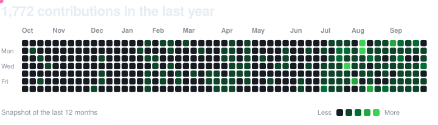
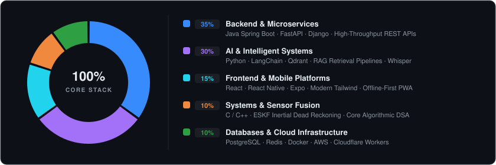
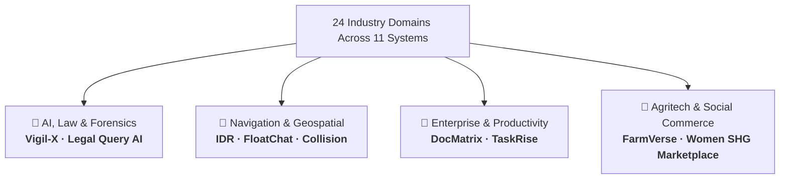

<div align="center">

<pre>
██████╗ ██████╗ ███████╗███╗   ███╗   ███╗   ██╗ █████╗ ██████╗  █████╗ ██╗   ██╗███╗   ██╗
██╔══██╗██╔══██╗██╔════╝████╗ ████║   ████╗  ██║██╔══██╗██╔══██╗██╔══██╗╚██╗ ██╔╝████╗  ██║
██████╔╝██████╔╝█████╗  ██╔████╔██║   ██╔██╗ ██║███████║██████╔╝███████║ ╚████╔╝ ██╔██╗ ██║
██╔═══╝ ██╔══██╗██╔══╝  ██║╚██╔╝██║   ██║╚██╗██║██╔══██║██╔══██╗██╔══██║  ╚██╔╝  ██║╚██╗██║
██║     ██║  ██║███████╗██║ ╚═╝ ██║   ██║ ╚████║██║  ██║██║  ██║██║  ██║   ██║   ██║ ╚████║
╚═╝     ╚═╝  ╚═╝╚══════╝╚═╝     ╚═╝   ╚═╝  ╚═══╝╚═╝  ╚═╝╚═╝  ╚═╝╚═╝  ╚═╝   ╚═╝   ╚═╝  ╚═══╝
</pre>

<h3>AI Engineer &nbsp;·&nbsp; Backend Developer &nbsp;·&nbsp; Full-Stack Builder</h3>

<p align="center">
  <em>Building systems that turn complex problems into practical software.</em>
</p>


<br/>
<a href="https://www.linkedin.com/in/prem-narayn-n-l-86097b327">LinkedIn</a> &nbsp;·&nbsp; <a href="mailto:naraynpremnl1304@gmail.com">Email</a> &nbsp;·&nbsp; <a href="https://github.com/premnarayn13?tab=repositories">Repositories</a> &nbsp;·&nbsp; <a href="https://leetcode.com/u/PremNaraynNL/">LeetCode</a> &nbsp;·&nbsp; <a href="https://www.codechef.com/users/prem_narayn">CodeChef</a>

</div>

```text
  login       : premnarayn13
  name        : Prem Narayn N L
  role        : AI Engineer · Backend Developer · Full-Stack Builder
  college     : Sri Eshwar College of Engineering
  degree      : B.Tech Artificial Intelligence & Data Science
  batch       : 2024–2028  (CGPA 8.6, 4th semester)
  community   : Co-Lead, Data Science · Google Developer Groups, SECE
  core        : Java · Python
  focus       : AI · backend · full-stack · systems
  exploring   : agentic systems · retrieval · on-device ML · quantum-assisted privacy
  projects    : 11 builds across 24 industry domains
  leetcode    : PremNaraynNL
  status      : ● building
```

<div align="center">

<picture>
  <source media="(prefers-color-scheme: light)" srcset="assets/ticker-light.svg"/>
  
</picture>

<br/>
<p align="center">
  
</p>
<p align="center">
  
</p>
<p align="center">
  
</p>

<p align="center">
  &nbsp;&nbsp;
  &nbsp;&nbsp;
  &nbsp;&nbsp;
  
</p>

</div>

<br/>

---

## Contribution Heatmap


<div align="center">

<picture>
  <source media="(prefers-color-scheme: light)" srcset="assets/heatmap-light.svg"/>
  
</picture>

<br/>

<picture>
  <source media="(prefers-color-scheme: light)" srcset="https://github-profile-summary-cards.vercel.app/api/cards/stats?username=premnarayn13&theme=vue"/>
  
</picture>
<picture>
  <source media="(prefers-color-scheme: light)" srcset="https://github-profile-summary-cards.vercel.app/api/cards/productive-time?username=premnarayn13&theme=vue&utcOffset=5.5"/>
  
</picture>

<br/>

<picture>
  <source media="(prefers-color-scheme: light)" srcset="https://github-profile-summary-cards.vercel.app/api/cards/profile-details?username=premnarayn13&theme=vue"/>
  
</picture>

<br/>

<br/>

---

## 🛠️ Technical Architecture & Core Stack

> *Writing reliable, scalable software with strong algorithmic fundamentals in Java and Python, paired with modern distributed backends, AI pipelines, and responsive platforms.*

### 📊 Architecture & Tech Stack Distribution

<div align="center">

<picture>
  <source media="(prefers-color-scheme: light)" srcset="assets/tech-chart-light.svg"/>
  
</picture>

</div>

<br/>

### 💻 Core Languages & Measured Volume

<table width="100%">
<tr>
<td width="20%" valign="top">
  <p align="center">
    
  </p>
  <h4 align="center">Java</h4>
  <p align="center"><code>Core · Production</code></p>
  <p>386 LeetCode<br/>300+ SkillRack<br/>5-Star HackerRank</p>
  <sub>Spring Boot, Microservices, Enterprise APIs</sub>
</td>
<td width="20%" valign="top">
  <p align="center">
    
  </p>
  <h4 align="center">Python</h4>
  <p align="center"><code>Core · AI & Data</code></p>
  <p>5 Major Builds<br/>AI & RAG Pipelines<br/>Scientific Computing</p>
  <sub>FastAPI, Django, LangChain, Qdrant, Pandas</sub>
</td>
<td width="20%" valign="top">
  <p align="center">
    
  </p>
  <h4 align="center">C / C++</h4>
  <p align="center"><code>Strong · Systems</code></p>
  <p>900+ SkillRack<br/>Inertial ESKF<br/>Sensor Fusion</p>
  <sub>Dead Reckoning, State Estimation, DSA</sub>
</td>
<td width="20%" valign="top">
  <p align="center">
    
  </p>
  <h4 align="center">JavaScript / TS</h4>
  <p align="center"><code>Strong · Full-Stack</code></p>
  <p>9 Major Builds<br/>Offline-First PWA<br/>Cross-Platform</p>
  <sub>React, React Native, Node.js, Express, Tailwind</sub>
</td>
<td width="20%" valign="top">
  <p align="center">
    
  </p>
  <h4 align="center">SQL</h4>
  <p align="center"><code>Database · Storage</code></p>
  <p>PostgreSQL<br/>MySQL & SQLite<br/>PostGIS Spatial</p>
  <sub>Schema Design, Indexing, Vector Search</sub>
</td>
</tr>
</table>

<br/>

### ⚙️ Specialized Engineering Domains

<table width="100%">
<tr>
<td width="33%" valign="top">
  <p align="center">
    
  </p>
  <h4 align="center">🧠 AI & Intelligent Systems</h4>
  <ul>
    <li><b>Frameworks:</b> LangChain, Hugging Face, Whisper</li>
    <li><b>Vector & Graph:</b> Qdrant, Neo4j, PostGIS</li>
    <li><b>Key Focus:</b> Agentic workflows, retrieval architectures (RAG), on-device ML, semantic search and OCR</li>
  </ul>
</td>
<td width="33%" valign="top">
  <p align="center">
    
  </p>
  <h4 align="center">⚙️ Backend & Systems</h4>
  <ul>
    <li><b>Frameworks:</b> Spring Boot, Django, FastAPI</li>
    <li><b>Databases & Cloud:</b> PostgreSQL, Redis, Docker, AWS, GCP</li>
    <li><b>Key Focus:</b> Layered microservices, high-throughput REST APIs, async task workers, quantum-safe privacy</li>
  </ul>
</td>
<td width="33%" valign="top">
  <p align="center">
    
  </p>
  <h4 align="center">🌐 Full-Stack & Platforms</h4>
  <ul>
    <li><b>Frontend & Mobile:</b> React, React Native, Expo</li>
    <li><b>Styling & Storage:</b> Tailwind CSS, IndexedDB, MongoDB</li>
    <li><b>Key Focus:</b> Modern responsive SPAs, offline-first architectures, service worker sync, mobile platforms</li>
  </ul>
</td>
</tr>
</table>

<br/>

---

## 🚀 Featured Engineering Builds

> *Production-ready builds spanning AI agents, non-GNSS navigation, offline-first PWAs, and distributed platforms.*

### 🧠 Sector 1: AI, Forensics & Intelligent Retrieval

<table width="100%">
<tr>
<td width="50%" valign="top">
  <h4><a href="https://github.com/Nithish-1622/VigilX-BE">Vigil-X</a> &nbsp;<code>AI & Forensics</code></h4>
  <p>Automated crime intelligence platform with speech-to-text audio ingestion (Whisper), document OCR, and graph correlation.</p>
  <p><code>FastAPI</code> · <code>Django REST</code> · <code>LangChain</code> · <code>Neo4j</code> · <code>Qdrant</code> · <code>React</code></p>
  <p><a href="https://github.com/Nithish-1622/VigilX-BE"></a></p>
</td>
<td width="50%" valign="top">
  <h4><a href="https://float-chat-1.vercel.app/dashboard">FloatChat</a> &nbsp;<code>Marine Telemetry</code></h4>
  <p>Conversational oceanographic assistant querying live telemetry from Argo floats and INCOIS datasets using geospatial RAG.</p>
  <p><code>FastAPI</code> · <code>React</code> · <code>PostgreSQL</code> · <code>PostGIS</code> · <code>Plotly</code> · <code>Pandas</code></p>
  <p><a href="https://float-chat-1.vercel.app/dashboard"></a></p>
</td>
</tr>
<tr>
<td width="50%" valign="top">
  <h4><a href="https://github.com/premnarayn13/SDMS">DocMatrix (SDMS)</a> &nbsp;<code>Document Retrieval</code></h4>
  <p>Enterprise document archive and semantic search engine with dense vector embeddings and multi-cloud synchronization.</p>
  <p><code>FastAPI</code> · <code>Supabase</code> · <code>PostgreSQL</code> · <code>React</code> · <code>Vercel</code></p>
  <p><a href="https://github.com/premnarayn13/SDMS"></a></p>
</td>
<td width="50%" valign="top">
  <h4><a href="https://drive.google.com/file/d/1TU1MBdvnDPN6GPI5mcM1OnkmWmjlNktN/view">Legal Query AI</a> &nbsp;<code>Legal Technology</code></h4>
  <p>Vector-similarity legal research engine matching inquiries to statutory provisions and judicial precedents with citations.</p>
  <p><code>Python</code> · <code>FastAPI</code> · <code>React</code> · <code>Vector DB</code> · <code>Tailwind CSS</code></p>
  <p><a href="https://drive.google.com/file/d/1TU1MBdvnDPN6GPI5mcM1OnkmWmjlNktN/view"></a></p>
</td>
</tr>
</table>

<br/>

### ⚡ Sector 2: Systems, Sensing & Autonomous Navigation

<table width="100%">
<tr>
<td width="50%" valign="top">
  <h4><a href="https://github.com/Nithish-1622/Dead-Reckoning-app">IDR Navigation</a> &nbsp;<code>Sensor Dynamics</code></h4>
  <p>Offline navigation system for GPS-denied environments, fusing IMU streams via Error-State Kalman Filtering with zero GNSS dependency.</p>
  <p><code>C++</code> · <code>Python</code> · <code>React Native</code> · <code>Expo</code> · <code>PostGIS</code> · <code>Celery</code></p>
  <p><a href="https://github.com/Nithish-1622/Dead-Reckoning-app"></a></p>
</td>
<td width="50%" valign="top">
  <h4><a href="https://drive.google.com/drive/folders/1Szz9FBKLRX4ddshaBoKaPStrCLomWMxG?usp=drive_link">Cooperative Collision Warning</a> &nbsp;<code>V2V Telemetry</code></h4>
  <p>Real-time vehicle-to-vehicle collision mitigation engine using sensor fusion, Kalman trajectory prediction, and live map alerts.</p>
  <p><code>Android</code> · <code>Java</code> · <code>Kalman Filter</code> · <code>GPS + IMU</code> · <code>Live Maps</code></p>
  <p><a href="https://drive.google.com/drive/folders/1Szz9FBKLRX4ddshaBoKaPStrCLomWMxG?usp=drive_link"></a></p>
</td>
</tr>
</table>

<br/>

### 🌐 Sector 3: Full-Stack Products & Cloud Platforms

<table width="100%">
<tr>
<td width="50%" valign="top">
  <h4><a href="https://github.com/premnarayn13/Habit_Hacker">Habit Hacker</a> &nbsp;<code>Offline PWA</code></h4>
  <p>Privacy-focused productivity PWA with client-side IndexedDB persistence, service worker offline caching, and analytics.</p>
  <p><code>React</code> · <code>Spring Boot</code> · <code>PostgreSQL</code> · <code>PWA</code> · <code>IndexedDB</code></p>
  <p><a href="https://github.com/premnarayn13/Habit_Hacker"></a></p>
</td>
<td width="50%" valign="top">
  <h4><a href="https://taskrise-v1.vercel.app/">TaskRise</a> &nbsp;<code>Collaborative Cloud</code></h4>
  <p>Task execution suite featuring real-time drag-and-drop Kanban boards, team workspaces, activity logging, and sprint metrics.</p>
  <p><code>MongoDB</code> · <code>Express.js</code> · <code>React</code> · <code>Node.js</code> · <code>Tailwind CSS</code></p>
  <p><a href="https://taskrise-v1.vercel.app/"></a></p>
</td>
</tr>
<tr>
<td width="50%" valign="top">
  <h4><a href="https://github.com/premnarayn13/WomenSelfHelpGroup-based_Ecom-Platform">Women SHG Marketplace</a> &nbsp;<code>E-Commerce</code></h4>
  <p>Multi-tenant marketplace empowering rural self-help groups with digital storefronts, inventory tracking, and payment flows.</p>
  <p><code>MongoDB</code> · <code>Express.js</code> · <code>React</code> · <code>Node.js</code> · <code>Tailwind CSS</code></p>
  <p><a href="https://github.com/premnarayn13/WomenSelfHelpGroup-based_Ecom-Platform"></a></p>
</td>
<td width="50%" valign="top">
  <h4>FarmVerse &nbsp;<code>Agritech & AI</code></h4>
  <p>Agricultural decision platform providing automated seasonal budgeting, crop yield projections, and planning via LLM inference.</p>
  <p><code>Java (Spring Boot)</code> · <code>React</code> · <code>PostgreSQL</code> · <code>Hibernate</code> · <code>Groq LLM</code></p>
  <p></p>
</td>
</tr>
</table>

<br/>

---

## 🌐 Industry Domain Coverage

> *Demonstrated implementation across 24 distinct industry domains through 11 purpose-built engineering projects.*

### 🗺️ Domain Architecture Mapping



<br/>

<table width="100%">
<tr>
<td width="33%" valign="top">
  <h4>🧠 AI, Law & Forensics</h4>
  <p><b>Legal Query AI · Vigil-X</b></p>
  <sub>Dense vector retrieval, Indian case law semantic search, OCR & speech-to-text forensic correlation.</sub>
</td>
<td width="33%" valign="top">
  <h4>🧭 Navigation & Geospatial</h4>
  <p><b>IDR · FloatChat · Collision</b></p>
  <sub>Inertial Dead Reckoning (ESKF), PostGIS spatial queries, Argo oceanographic float telemetry.</sub>
</td>
<td width="33%" valign="top">
  <h4>🏢 Enterprise & Productivity</h4>
  <p><b>DocMatrix · TaskRise</b></p>
  <sub>Hybrid keyword-vector search, cloud document syncing, real-time collaborative Kanban.</sub>
</td>
</tr>
<tr>
<td width="33%" valign="top">
  <h4>🔒 Cybersecurity & Systems</h4>
  <p><b>SCADA Quantum Privacy · Collision</b></p>
  <sub>Quantum-safe communication protocols, V2V low-latency telemetry broadcasting.</sub>
</td>
<td width="33%" valign="top">
  <h4>🌱 Agritech & Life Sciences</h4>
  <p><b>FarmVerse · IBET-Net</b></p>
  <sub>Predictive crop yield modeling, neural bio-effect simulation, agricultural resource planning.</sub>
</td>
<td width="33%" valign="top">
  <h4>🛍️ Commerce & Social Solutions</h4>
  <p><b>Women SHG · Habit Hacker</b></p>
  <sub>Multi-tenant rural marketplace, role-based access control, offline-first local PWA storage.</sub>
</td>
</tr>
</table>

<br/>

<details>
<summary><b>📊 View Complete 24-Domain Breakdown Matrix</b></summary>
<br/>

| Project | Covered Industry Verticals |
| :--- | :--- |
| **Legal Query AI** | Legal & Justice · Artificial Intelligence & Automation · Computer Science & Software · Education & Academia |
| **Vigil-X** | Legal & Justice · Safety & Forensics · Artificial Intelligence & Automation · Public Administration |
| **DocMatrix** | Computer Science & Software · Artificial Intelligence & Automation · Cloud Infrastructure |
| **Collision Prevention** | Transportation & Automotive · Physics & Sensor Dynamics · Safety & Emergency |
| **IDR Navigation** | Transportation & Automotive · Sensor Dynamics · Geospatial & Remote Sensing · Logistics & Supply Chain |
| **FloatChat** | Marine & Oceanography · Climate & Weather · Environmental Resources · Artificial Intelligence · Geospatial |
| **Women SHG E-Commerce** | Retail & E-Commerce · Business & Management · Social Sciences · Consumer Solutions |
| **SCADA Quantum Privacy** | Cybersecurity · Telecommunications & Networking · Emerging & Frontier Technologies |
| **Habit Hacker** | Computer Science & Software · Lifestyle & Personal Productivity · Offline PWA |
| **FarmVerse** | Agriculture & Food Systems · Artificial Intelligence · Business & Budgeting |
| **IBET-Net** | Agriculture · Biotechnology & Life Sciences · Neural Modelling · Veterinary Science |

</details>

<br/>

---

## 💡 Algorithmic Problem Solving

<div align="center">

<picture>
  <source media="(prefers-color-scheme: light)" srcset="assets/coding-light.svg"/>
  
</picture>

<br/><br/>

<table width="100%">
<tr>
<td align="center" width="20%">
  <sub>Contest Rating</sub><br/>
  <b>1,917 (Knight)</b>
</td>
<td align="center" width="20%">
  <sub>Global Ranking</sub><br/>
  <b>Top 4.24% (#36,778)</b>
</td>
<td align="center" width="20%">
  <sub>Problems Solved</sub><br/>
  <b>467 / 4,115</b>
</td>
<td align="center" width="20%">
  <sub>Annual Submissions</sub><br/>
  <b>1,235 (329 Active Days)</b>
</td>
<td align="center" width="20%">
  <sub>Max Streak</sub><br/>
  <b>137 Days</b>
</td>
</tr>
</table>

<br/>

<a href="https://leetcode.com/u/PremNaraynNL/">
  
</a>&nbsp;&nbsp;
<a href="https://www.codechef.com/users/prem_narayn">
  
</a>&nbsp;&nbsp;
<a href="https://github.com/premnarayn13?tab=repositories">
  
</a>

</div>

<br/>

---

## 🤝 Connect & Collaborate

<div align="center">

<p align="center">
  
</p>

> **Software Engineer & AI Systems Builder**
>
> Specialized in scalable backend architectures, intelligent retrieval pipelines, and algorithmic problem solving. Open to full-stack and AI software engineering roles, hackathons, and high-impact open-source collaborations.

<br/>

<table width="100%">
<tr>
<td width="33%" valign="top">
  <h4>🎯 Primary Focus</h4>
  <p>Scalable backend architectures in Java & Python, high-throughput microservices, and clean REST APIs.</p>
</td>
<td width="33%" valign="top">
  <h4>🚀 Frontier Technologies</h4>
  <p>Agentic workflows, dense vector RAG, quantum-resistant privacy protocols, and on-device ML.</p>
</td>
<td width="33%" valign="top">
  <h4>🤝 Collaboration Modes</h4>
  <p>Full-stack and AI engineering roles, open-source projects, and competitive hackathon builds.</p>
</td>
</tr>
</table>

<br/>

<p align="center">
  <a href="https://www.linkedin.com/in/prem-narayn-n-l-86097b327">
    
  </a>&nbsp;&nbsp;
  <a href="mailto:naraynpremnl1304@gmail.com">
    
  </a>&nbsp;&nbsp;
  <a href="https://github.com/premnarayn13">
    
  </a>&nbsp;&nbsp;
  <a href="https://leetcode.com/u/PremNaraynNL/">
    
  </a>
</p>

</div>
