<div align="center">

<picture>
  <source media="(prefers-color-scheme: light)" srcset="assets/hero-light.svg"/>
  
</picture>


<br/>

<a href="https://www.linkedin.com/in/prem-narayn-n-l-86097b327">LinkedIn</a> &nbsp;·&nbsp; <a href="mailto:naraynpremnl1304@gmail.com">Email</a> &nbsp;·&nbsp; <a href="https://github.com/premnarayn13?tab=repositories">Repositories</a> &nbsp;·&nbsp; <a href="https://leetcode.com/u/PremNaraynNL/">LeetCode</a> &nbsp;·&nbsp; <a href="https://www.codechef.com/users/prem_narayn">CodeChef</a>

</div>

```text
  login       : premnarayn13
  name        : Prem Narayn N L
  role        : AI Engineer · Backend Developer · Full-Stack Builder
  college     : Sri Eshwar College of Engineering
  degree      : B.Tech Artificial Intelligence & Data Science
  batch       : 2024–2028  (CGPA 8.6, 4th semester)
  community   : Co-Lead, Data Science · Google Developer Groups, SECE
  core        : Java · Python
  focus       : AI · backend · full-stack · systems
  exploring   : agentic systems · retrieval · on-device ML · quantum-assisted privacy
  projects    : 11 builds across 24 industry domains
  leetcode    : PremNaraynNL
  status      : ● building
```

<div align="center">

<picture>
  <source media="(prefers-color-scheme: light)" srcset="assets/ticker-light.svg"/>
  
</picture>

<br/>

<p align="center">
  
</p>
<p align="center">
  
</p>
<p align="center">
  
</p>
<p align="center">
  
</p>

<p align="center">
  &nbsp;&nbsp;
  &nbsp;&nbsp;
  &nbsp;&nbsp;
  
</p>

</div>

<br/>

<br/>

---

### Contribution Heatmap


<div align="center">

<picture>
  <source media="(prefers-color-scheme: light)" srcset="assets/heatmap-light.svg"/>
  
</picture>

<br/>

<picture>
  <source media="(prefers-color-scheme: light)" srcset="https://github-profile-summary-cards.vercel.app/api/cards/stats?username=premnarayn13&theme=vue"/>
  
</picture>
<picture>
  <source media="(prefers-color-scheme: light)" srcset="https://github-profile-summary-cards.vercel.app/api/cards/productive-time?username=premnarayn13&theme=vue&utcOffset=5.5"/>
  
</picture>

<br/>

<picture>
  <source media="(prefers-color-scheme: light)" srcset="https://github-profile-summary-cards.vercel.app/api/cards/profile-details?username=premnarayn13&theme=vue"/>
  
</picture>

<br/>
</div>


<div align="center">

<picture>
  <source media="(prefers-color-scheme: light)" srcset="assets/usage-light.svg"/>
  
</picture>

</div>


<br/>

---


### Languages I Write Best


<div align="center">

<picture>
  <source media="(prefers-color-scheme: light)" srcset="assets/langs-light.svg"/>
  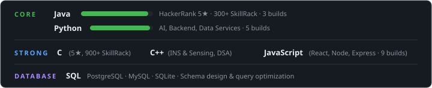
</picture>

<br/>

<p align="center">
  
</p>

</div>


<br/>

---


### Engineering Focus & Core Stack


<div align="center">

<table width="100%">
<tr>
<td width="33%" valign="top">

<h4 align="center">AI & Intelligent Systems</h4>

<p align="center">
  
</p>

- **Core**: Python · FastAPI · Scikit-learn
- **Frameworks**: LangChain · Hugging Face
- **Data & Vector**: Pandas · NumPy · Qdrant · Neo4j
- **Focus**: Agentic systems, retrieval architectures (RAG), on-device ML, semantic search & OCR

</td>
<td width="33%" valign="top">

<h4 align="center">Backend & Systems</h4>

<p align="center">
  
</p>

- **Core**: Java (Spring Boot) · Python (Django, FastAPI)
- **Databases**: PostgreSQL · Redis · MySQL · SQLite
- **DevOps**: Docker · AWS · GCP · GitHub Actions
- **Focus**: Layered microservices, REST APIs, async task workers, secure auth & quantum privacy

</td>
<td width="33%" valign="top">

<h4 align="center">Full-Stack & Platforms</h4>

<p align="center">
  
</p>

- **Core**: React · Node.js · Express · TypeScript / JS
- **Styling & UI**: Tailwind CSS · Bootstrap
- **Mobile & Web**: React Native · Expo · PWA (Service Workers)
- **Focus**: Modern SPAs, offline-first architectures, real-time sync & cross-platform apps

</td>
</tr>
</table>

</div>


<br/>

---


### What I Have Built


<div align="center">

<picture>
  <source media="(prefers-color-scheme: light)" srcset="assets/timeline-light.svg"/>
  
</picture>

<br/><br/>

</div>

<details>
<summary align="center"><b>Featured Builds & Systems (Click to expand — 10 projects)</b></summary>

<br/>

<div align="center">

<picture>
  <source media="(prefers-color-scheme: light)" srcset="assets/card-idr-light.svg"/>
  
</picture>

<p>
<picture>
  <source media="(prefers-color-scheme: light)" srcset="https://skillicons.dev/icons?i=cpp,py,react,django,postgres,redis,sqlite&theme=light"/>
  
</picture>
</p>

<p>&nbsp;<sub><b>React Native</b></sub>&nbsp;&nbsp;&nbsp;&nbsp;<sub><b>Expo</b></sub>&nbsp;&nbsp;&nbsp;&nbsp;<sub><b>ONNX</b></sub>&nbsp;&nbsp;&nbsp;&nbsp;<sub><b>Celery</b></sub>&nbsp;&nbsp;&nbsp;&nbsp;<sub><b>OpenStreetMap</b></sub></p>

<sub>ESKF · PostGIS</sub>

<sub><a href="https://github.com/Nithish-1622/Dead-Reckoning-app">Repository</a></sub>

</div>

<div align="center">

<picture>
  <source media="(prefers-color-scheme: light)" srcset="assets/card-vigilx-light.svg"/>
  
</picture>

<p>
<picture>
  <source media="(prefers-color-scheme: light)" srcset="https://skillicons.dev/icons?i=react,tailwind,py,django,fastapi,postgres,sklearn&theme=light"/>
  
</picture>
</p>

<p>&nbsp;&nbsp;&nbsp;&nbsp;&nbsp;&nbsp;&nbsp;&nbsp;&nbsp;&nbsp;&nbsp;&nbsp;&nbsp;<sub><b>LangChain</b></sub>&nbsp;&nbsp;&nbsp;&nbsp;<sub><b>Qdrant</b></sub>&nbsp;&nbsp;&nbsp;&nbsp;<sub><b>SQLAlchemy</b></sub>&nbsp;&nbsp;&nbsp;&nbsp;<sub><b>Zoho Catalyst</b></sub></p>

<sub>LangGraph · Django REST Framework · OCR · Whisper</sub>

<sub><a href="https://github.com/Nithish-1622/VigilX-BE">Repository</a></sub>

</div>

<div align="center">

<picture>
  <source media="(prefers-color-scheme: light)" srcset="assets/card-docmatrix-light.svg"/>
  
</picture>

<p>
<picture>
  <source media="(prefers-color-scheme: light)" srcset="https://skillicons.dev/icons?i=react,js,tailwind,py,fastapi,postgres,supabase,vercel,git&theme=light"/>
  
</picture>
</p>

<p>&nbsp;<sub><b>Google Drive</b></sub>&nbsp;&nbsp;&nbsp;&nbsp;<sub><b>MEGA</b></sub>&nbsp;&nbsp;&nbsp;&nbsp;<sub><b>Render</b></sub></p>

<sub>RAG · embeddings</sub>

<sub><a href="https://github.com/premnarayn13/SDMS">Repository</a></sub>

</div>

<div align="center">

<picture>
  <source media="(prefers-color-scheme: light)" srcset="assets/card-legal-light.svg"/>
  
</picture>

<p>
<picture>
  <source media="(prefers-color-scheme: light)" srcset="https://skillicons.dev/icons?i=react,tailwind,py,fastapi&theme=light"/>
  
</picture>
</p>

<sub>RAG · embeddings · cosine similarity · vector database · NLP</sub>

<sub><a href="https://drive.google.com/file/d/1TU1MBdvnDPN6GPI5mcM1OnkmWmjlNktN/view">Demo video</a></sub>

</div>

<div align="center">

<picture>
  <source media="(prefers-color-scheme: light)" srcset="assets/card-floatchat-light.svg"/>
  
</picture>

<p>
<picture>
  <source media="(prefers-color-scheme: light)" srcset="https://skillicons.dev/icons?i=react,js,py,fastapi,postgres&theme=light"/>
  
</picture>
</p>

<p>&nbsp;<sub><b>Pandas</b></sub>&nbsp;&nbsp;&nbsp;&nbsp;<sub><b>NumPy</b></sub>&nbsp;&nbsp;&nbsp;&nbsp;<sub><b>Plotly</b></sub></p>

<sub>PostGIS · LLM · RAG · Argo and INCOIS datasets</sub>

<sub><a href="https://float-chat-1.vercel.app/dashboard">MVP</a></sub>

</div>

<div align="center">

<picture>
  <source media="(prefers-color-scheme: light)" srcset="assets/card-farm-light.svg"/>
  
</picture>

<p>
<picture>
  <source media="(prefers-color-scheme: light)" srcset="https://skillicons.dev/icons?i=java,spring,react,bootstrap,postgres&theme=light"/>
  
</picture>
</p>

<p>&nbsp;&nbsp;&nbsp;&nbsp;<sub><b>Spring Security</b></sub>&nbsp;&nbsp;&nbsp;&nbsp;<sub><b>Hibernate</b></sub>&nbsp;&nbsp;&nbsp;&nbsp;<sub><b>Axios</b></sub></p>

<sub>gpt-oss-120b</sub>

</div>

<div align="center">

<picture>
  <source media="(prefers-color-scheme: light)" srcset="assets/card-collision-light.svg"/>
  
</picture>

<p>&nbsp;<sub><b>Android</b></sub></p>

<sub>GPS + IMU · Kalman filter · real-time vehicle communication · live map</sub>

<sub><a href="https://drive.google.com/drive/folders/1Szz9FBKLRX4ddshaBoKaPStrCLomWMxG?usp=drive_link">Project folder</a></sub>

</div>

<div align="center">

<picture>
  <source media="(prefers-color-scheme: light)" srcset="assets/card-habit-light.svg"/>
  
</picture>

<p>
<picture>
  <source media="(prefers-color-scheme: light)" srcset="https://skillicons.dev/icons?i=react,java,spring,postgres,js&theme=light"/>
  
</picture>
</p>

<p>&nbsp;<sub><b>PWA</b></sub>&nbsp;&nbsp;&nbsp;&nbsp;<sub><b>Spring Security</b></sub>&nbsp;&nbsp;&nbsp;&nbsp;<sub><b>JWT</b></sub></p>

<sub>Spring AI · Service Workers · IndexedDB</sub>

<sub><a href="https://github.com/premnarayn13/Habit_Hacker">Repository</a></sub>

</div>

<div align="center">

<picture>
  <source media="(prefers-color-scheme: light)" srcset="assets/card-wshg-light.svg"/>
  
</picture>

<p>
<picture>
  <source media="(prefers-color-scheme: light)" srcset="https://skillicons.dev/icons?i=react,nodejs,express,mongodb,tailwind&theme=light"/>
  
</picture>
</p>

<sub>MERN · role-based access</sub>

<sub><a href="https://github.com/premnarayn13/WomenSelfHelpGroup-based_Ecom-Platform">Repository</a></sub>

</div>

<div align="center">

<picture>
  <source media="(prefers-color-scheme: light)" srcset="assets/card-taskrise-light.svg"/>
  
</picture>

<p>
<picture>
  <source media="(prefers-color-scheme: light)" srcset="https://skillicons.dev/icons?i=react,nodejs,express,mongodb,tailwind&theme=light"/>
  
</picture>
</p>

<sub>MERN</sub>

<sub><a href="https://taskrise-v1.vercel.app/">MVP</a></sub>

</div>

</details>

<br/>

---

</div>
<br>
### Domains I Have Worked In

<table width="100%">
<tr>
<td>

| Project | Core Domain & Focus | Type | Themes |
|:---|:---|:---:|:---:|
| **Legal Query AI** | Legal & Justice · AI Retrieval · Academia | AI-first | `4` |
| **Vigil-X** | Crime Intelligence · Safety & Forensics | AI-first | `5` |
| **DocMatrix** | Intelligent Document Agent · Software | AI-first | `2` |
| **Collision Prevention** | Cooperative Collision Warnings · Physics | Systems | `3` |
| **IDR** | Non-GNSS Navigation · Geospatial Logistics | Systems | `4` |
| **FloatChat** | Conversational Ocean & Climate Data | AI-first | `8` |
| **Women SHG E-Commerce** | Community Marketplace · Retail & Social | Product | `4` |
| **SCADA Quantum Privacy** | Quantum Privacy · SCADA Cybersecurity | Systems | `3` |
| **Habit Hacker** | Local-First Productivity PWA · Lifestyle | Product | `2` |
| **FarmVerse** | Farm Planning & AI Costing · Agriculture | AI-first | `3` |
| **IBET-Net** | Bio-Effect Neural Modelling · Life Sciences | Research | `4` |
| **Coverage Summary** | **24 Industry Domains Across All Builds** | **11 Builds** | **42** |

<details>
<summary><b>View Full Granular Domain Mapping Matrix</b></summary>
<br/>

| Project | Full List of Covered Industry Themes |
|:---|:---|
| **Legal Query AI** | Legal & Justice · Artificial Intelligence & Automation · Computer Science & Software · Education & Academia |
| **Vigil-X** | Legal & Justice · Artificial Intelligence & Automation · Safety, Emergency & Forensics · Computer Science & Software · Government & Public Administration |
| **DocMatrix** | Computer Science & Software · Artificial Intelligence & Automation |
| **Collision Prevention** | Transportation & Automotive · Physics & Nuclear Science · Safety, Emergency & Forensics |
| **IDR** | Transportation & Automotive · Physics & Nuclear Science · Geospatial & Remote Sensing · Logistics & Supply Chain |
| **FloatChat** | Marine & Ocean · Environment & Climate · Weather & Disaster Management · Water & Natural Resources · Artificial Intelligence & Automation · Geospatial & Remote Sensing · Education & Academia · Logistics & Supply Chain |
| **Women SHG E-Commerce** | Retail & E-Commerce · Business & Management · Social Sciences · Consumer & Lifestyle |
| **SCADA Quantum Privacy** | Cybersecurity · Telecommunications & Networking · Emerging & Frontier Technologies |
| **Habit Hacker** | Computer Science & Software · Consumer & Lifestyle |
| **FarmVerse** | Agriculture & Food · Artificial Intelligence & Automation · Business & Management |
| **IBET-Net** | Agriculture & Food · Biotechnology & Life Sciences · Artificial Intelligence & Automation · Veterinary & Animal Sciences |

</details>

<details>
<summary><b>Themes not yet explored (26)</b></summary>
<br/>

Healthcare & Medicine · Pharmaceuticals · Chemistry & Chemical Sciences · Energy & Power · Electrical & Electronics · Mechanical & Manufacturing · Civil Engineering & Construction · Architecture & Urban Planning · Aerospace & Space · Earth & Geological Sciences · Robotics & Autonomous Systems · Semiconductors & Advanced Materials · Defence & National Security · Archaeology & Cultural Heritage · History, Literature & Humanities · Psychology & Human Behaviour · Finance, Banking & Insurance · Economics & Policy · Media, Journalism & Communication · Arts, Design & Entertainment · Sports & Fitness · Tourism & Hospitality · Real Estate & Property · Mining & Natural Resources · Fashion & Textiles · Religion, Philosophy & Ethics

</details>

</td>
</tr>
</table>
<br>

<br/>

---


### Research Focus


<div align="center">

<picture>
  <source media="(prefers-color-scheme: light)" srcset="assets/research-light.svg"/>
  
</picture>

</div>


<br/>

---


### Problem Solving


<div align="center">
<br><br/>
<picture>
  <source media="(prefers-color-scheme: light)" srcset="assets/coding-light.svg"/>
  
</picture>

<br/><br/>

<picture>
  <source media="(prefers-color-scheme: light)" srcset="assets/leetcode-light.svg"/>
  
</picture>

<br/><br/>

<sub>HackerRank 5-star in Java and C · focus on DSA, algorithms, optimisation and logic</sub>

</div>
<br/>
<details>
<summary><b>Competitions and recognition</b></summary>
<br/>

- Winner · Hack-Sprint 2026 (Google Developer Groups, Google tools challenge) · Winner · AgentVerse 2026
- Pre-finalist · Google BigCode 2026 (top 1500 among 11 lakh candidates)
- Runner-up · GenAI Hackathon (IBM and SmartBridge) 2025 · AI-Datathon 2025 · Qubitron 2025 (Coimbatore Institute of Technology)
- Best Coding Performer · CodeLee 2025 (intra-college)
- Winner · Creatation (intra-college) · Runner-up · Thiran 2.0 and Technova 2025 (intra-college)
- Finalist · All-India Coding Championship (72 of 2500)
</details>


<br/>

---


<div align="center">

<picture>
  <source media="(prefers-color-scheme: dark)" srcset="https://streak-stats.demolab.com?user=premnarayn13&background=0D1117&border=30363D&ring=3FB950&fire=FB923C&currStreakLabel=3FB950&currStreakNum=E6EDF3&sideLabels=3FB950&sideNums=E6EDF3&dates=8B949E"/>
  
</picture>

<br/><br/>

<picture>
  <source media="(prefers-color-scheme: light)" srcset="assets/closing-light.svg"/>
  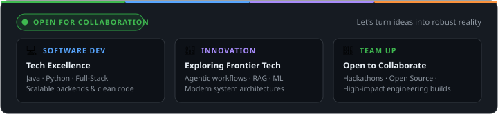
</picture>

<br/>

<a href="https://www.linkedin.com/in/prem-narayn-n-l-86097b327">LinkedIn</a> &nbsp;·&nbsp; <a href="mailto:naraynpremnl1304@gmail.com">Email</a> &nbsp;·&nbsp; <a href="https://github.com/premnarayn13">GitHub</a>

</div>
